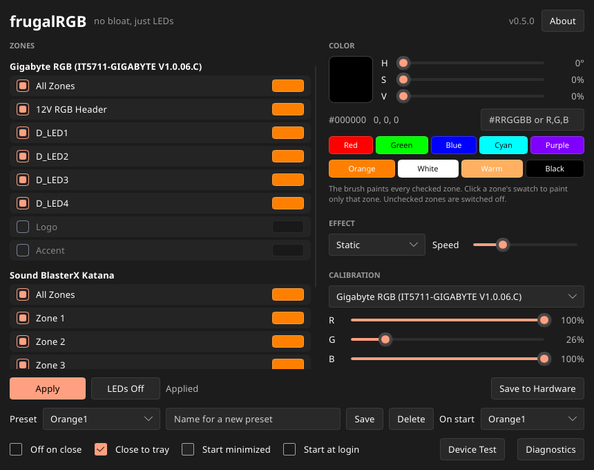

# frugalRGB: no bloat, just LEDs

A small standalone RGB controller for PC hardware. I built it for my own machines as a replacement for [SignalRGB](https://signalrgb.com/) (too bloated) and [OpenRGB](https://openrgb.org/) (conflicts with Stream Deck, buggy on some hardware).

It is one native executable. Sitting in the tray it uses about 20 MB of RAM (measured on Linux with KDE; the Python version it replaces used 89 MB).



## Supported devices

This app was built for my specific hardware. It currently supports:

| Device | Connection | Notes |
|--------|-----------|-------|
| ASRock Polychrome USB (VID `26CE`, PID `01A2`) | USB HID | Tested on ASRock Z890M Riptide. No admin needed. |
| MSI Mystic Light (VID `1462`, 185-byte protocol) | USB HID | Tested on MSI MPG Z790I EDGE WIFI (PID `7E03`). No admin needed. |
| Gigabyte RGB Fusion 2.0 (VID `048D`, ITE IT5711/IT5702/IT8297) | USB HID | Tested on Gigabyte X870E Aorus Master X3D. No admin needed. |
| ASUS Aura USB (VID `0B05`) | USB HID | Mainboard protocol. Onboard RGB and addressable headers are read from the device's config table (PIDs `19AF`/`1939`/`18F3`). No admin needed. |
| Creative Sound BlasterX Katana (VID `041E`, PID `3247`) | USB HID | Soundbar with 49 LEDs. Static (one color or one per zone), breathing, color cycle and rainbow wave, all run by the soundbar itself. Edits the active device profile, so changes persist on the device like with the official app. No admin needed. |
| ASUS GPU RGB (ENE controller at I2C `0x67`) | NvAPI I2C (Windows), i2c-dev (Linux) | Tested on ASUS TUF RTX 5090. No admin needed (Linux: `i2c` group). NVIDIA cards only. |
| ENE AUDA-series DDR5 RAM (addresses `0x70` to `0x77`) | SMBus (i801/PIIX4) | Tested with KLEVV DDR5 RGB. Needs admin on Windows (kernel-level SMBus access). On Linux the `i2c` group is enough. Intel (i801) and AMD (PIIX4) chipsets. |

### About 0.4.0

Version 0.4.0 is a rewrite in Rust. Every driver was ported from the Python one and has to reproduce, byte for byte, what the Python driver sent to a simulated device. On real hardware I have so far only re-tested the Gigabyte board and the Katana, on Linux. If your device behaves differently than it did with 0.3.0, please [open an issue](../../issues) with the diagnostics file. 0.3.0 stays on the [Releases](../../releases) page.

Presets and settings carry over. One behavior changed on purpose. An unchecked zone is now switched off. Before, it was skipped and kept whatever it was showing.

### What about my hardware?

The Diagnostics button writes `frugalrgb_diagnostics.txt` to your Desktop: system details, every USB HID device, an SMBus scan, register dumps of the detected controllers and your config. On Windows, run as administrator so it can include the RAM. `frugalrgb diagnostics` prints the same report in a terminal.

If you'd like support for your hardware, [open an issue](../../issues) and attach that file. I'll look into it when I can, but this is a personal project and I can't promise anything.

## Features

- Static color from the HSV sliders, the color buttons, or a typed `#RRGGBB` or `R,G,B` value.
- Breathing, color cycle, rainbow and strobe with adjustable speed. Devices that have the effect built in run it themselves. The others get frames from frugalRGB at 30 fps.
- **Per-zone color.** Every RGB zone (Logo, Accent, D_LED1, LED 1 to 8, etc.) is its own row with its own color and checkbox. An unchecked zone is switched off, even when "All Zones" is checked. Uncheck every zone of a device and frugalRGB leaves that device alone.
- Per-device calibration with three sliders that scale red, green and blue, for LEDs whose white is off.
- Presets store each zone's color and checkbox, the effect and the speed. One of them can be applied at startup.
- Tray icon with a menu to show the window, load a preset, switch the LEDs off or quit. The window can close to the tray and start hidden in it.
- **Start at login.** On Linux this writes an XDG autostart entry to `~/.config/autostart/`. On Windows it puts a shortcut in the Startup folder. When frugalRGB runs as administrator, the shortcut starts a scheduled task that brings the app up elevated at login without a UAC prompt, which RAM RGB needs. Windows Defender may flag the creation of that task.
- **Save to Hardware** writes the current color and mode to the device's flash, so it is there at power-on. Read the [warning](#save-to-hardware-warning) first.
- **Device Test** lights one device in red, green, blue and white, then puts your colors back. It shows whether the device answers at all and whether its color channels are in the right order.
- Command line for scripts: see [below](#command-line).
- Only one instance runs at a time. Starting frugalRGB again brings up the window of the one already running (on Windows it tells you to look in the tray).

## Installation

### Windows

Download `frugalRGB-<version>-windows-x64.zip` from the [Releases](../../releases) page, extract it and run `frugalRGB.exe`.

- Motherboard and other USB RGB (ASRock, MSI, Gigabyte, ASUS, Katana) and ASUS GPU RGB work without admin.
- RAM RGB needs [PawnIO](https://pawnio.eu/) installed and frugalRGB started with "Run as administrator". The SMBus modules PawnIO loads are built into the exe.

The exe is not signed, so SmartScreen may warn the first time you run it ("More info", then "Run anyway").

Close other RGB software first (Armoury Crate, RGB Fusion, Mystic Light, SignalRGB). Two programs driving the same controller overwrite each other.

### Arch Linux (AUR)

**1. Install** [frugalrgb from the AUR](https://aur.archlinux.org/packages/frugalrgb) (the PKGBUILD lives in [`aur/`](aur/)):

```bash
yay -S frugalrgb
```

This installs the `frugalrgb` command, an application menu entry, the udev rules for USB RGB access, and autoload config for the SMBus kernel modules (`i2c-dev`, `i2c-piix4`, `i2c-i801`).

**2. Activate device access** (first install only; a reboot does the same):

```bash
sudo udevadm trigger                        # apply the udev rules without replugging
sudo modprobe i2c-dev i2c-piix4 i2c-i801    # load the SMBus modules without rebooting
```

Loading the wrong chipset's module is harmless. It won't bind.

**3. Join the `i2c` group** (needed for RAM RGB and GPU RGB):

```bash
sudo usermod -aG i2c $USER
```

Then log out and back in for the group to take effect.

**4. Gigabyte boards only, for RAM RGB:** the BIOS claims the SMBus region and the kernel refuses to bind the driver (`dmesg` shows `ACPI Warning: SystemIO range ... conflicts with OpRegion`). Add the kernel parameter `acpi_enforce_resources=lax` and reboot:

- GRUB: append it to `GRUB_CMDLINE_LINUX_DEFAULT` in `/etc/default/grub`, then `sudo grub-mkconfig -o /boot/grub/grub.cfg`
- systemd-boot: append it to the `options` line of your entry in `/boot/loader/entries/`
- Limine (CachyOS): add `KERNEL_CMDLINE[default]+=" acpi_enforce_resources=lax"` to `/etc/default/limine`, then `sudo limine-update`

RGB tools use the same access pattern under Windows, where no such check exists. OpenRGB documents the same parameter. Skip this step if you don't need RAM RGB.

**5. Run** `frugalrgb` from a terminal, or launch frugalRGB from the application menu.

### Ubuntu / Debian (.deb)

**1. Install** the `.deb` from the [Releases](../../releases) page (or build it yourself, see below):

```bash
sudo apt install ./frugalrgb_*.deb
```

This installs the `frugalrgb` command, an application menu entry, the udev rules for USB RGB access, autoload config for the SMBus kernel modules and, via Recommends, `i2c-tools` (which provides the `i2c` group and device permissions). The post-install script reloads udev and loads the SMBus modules, so no reboot is needed. The package is built on Ubuntu 22.04 and needs that or newer.

**2. Join the `i2c` group** (needed for RAM RGB and GPU RGB):

```bash
sudo usermod -aG i2c $USER
```

Then log out and back in for the group to take effect. If the group doesn't exist, `i2c-tools` was skipped. Run `sudo apt install i2c-tools` first.

**3. Gigabyte boards only, for RAM RGB:** add the kernel parameter `acpi_enforce_resources=lax` (step 4 of the AUR section says why). Append it to `GRUB_CMDLINE_LINUX_DEFAULT` in `/etc/default/grub`, then `sudo update-grub` and reboot.

**4. Run** `frugalrgb` from a terminal, or launch frugalRGB from the application menu.

To build the package yourself:

```bash
sudo apt install pkg-config libudev-dev libfontconfig1-dev    # plus Rust, see below
bash packaging/build_deb.sh    # output: dist/frugalrgb_<version>_<arch>.deb
```

### From source

You need Rust 1.89 or newer ([rustup](https://rustup.rs/)). On Linux, also the headers for udev and fontconfig:

```bash
sudo pacman -S fontconfig systemd-libs                        # Arch
sudo apt install pkg-config libudev-dev libfontconfig1-dev    # Debian/Ubuntu
```

On Windows, the MSVC toolchain with the Visual Studio C++ build tools.

```bash
git clone https://github.com/emaspa/frugalRGB.git
cd frugalRGB
cargo build --release -p frugalrgb    # output: target/release/frugalrgb
```

`cargo build --release -p frugalrgb --no-default-features` builds the command line alone, without the window and tray.

On Linux, a build run from the source tree still needs device access. For USB RGB, install the udev rules, then replug or retrigger:

```bash
sudo cp 70-frugalrgb.rules /etc/udev/rules.d/
sudo udevadm control --reload && sudo udevadm trigger
```

For RAM and GPU RGB, join the `i2c` group and load `i2c-dev` plus the chipset SMBus driver:

```bash
# Debian/Ubuntu only: stock installs have no i2c group. i2c-tools creates it
# and installs the udev rule that makes /dev/i2c-* group-accessible:
sudo apt install i2c-tools

sudo usermod -aG i2c $USER    # then log out and back in
# i2c-dev exposes the /dev/i2c-* nodes; i2c-piix4 is the AMD chipset
# driver (Intel: i2c-i801 instead)
printf 'i2c-dev\ni2c-piix4\n' | sudo tee /etc/modules-load.d/frugalrgb.conf
sudo modprobe i2c-dev i2c-piix4
```

Gigabyte boards also need `acpi_enforce_resources=lax` for RAM RGB, as described in step 4 of the AUR section.

Linux support is only tested on CachyOS (Arch-based). Other distributions should work but are untested. The tray icon uses the StatusNotifierItem protocol, which KDE supports natively and GNOME supports through the AppIndicator extension.

`packaging/build_windows.ps1` builds the Windows zip.

## Command line

Without arguments `frugalrgb` opens the window. With a command it does one thing and exits:

```
frugalrgb list             Show detected devices and their zones
frugalrgb presets          Show saved presets
frugalrgb apply [PRESET]   Apply a preset (default: the startup preset)
frugalrgb off              Switch every LED off
frugalrgb test             Show red, green, blue and white on every device
frugalrgb diagnostics      Print a report on the hardware for a bug report
```

Add `-v` to see what is being detected and written.

`frugalrgb apply` is the "set and forget" setup. Run it at login and nothing stays in memory. It only keeps running when the preset uses an effect that a device cannot run by itself, because then frugalRGB has to send the frames. `--apply-quit`, the flag older versions used for this, still works.

## Configuration

Config files are stored in your home directory:

- `~/.frugalrgb_config.json`: calibration, UI options, startup preset
- `~/.frugalrgb_presets.json`: saved presets

### Save to Hardware warning

The Save to Hardware button writes the current color and mode to the device's non-volatile flash memory, so it persists across power cycles and shows before the operating system loads. It is offered for ENE RAM and GPU controllers, Gigabyte RGB Fusion 2.0 and ASUS Aura mainboard controllers.

> **Use at your own risk.** This operation is known to be unstable on some ENE firmware versions. In rare cases it can soft-lock the RGB controller, making the LEDs unresponsive. Recovery typically requires physically reseating the DIMM. OpenRGB disables this feature by default for the same reason.
>
> The app asks for confirmation twice before saving. Click Apply with the color and mode you want before you save.
>
> If you only want your color applied at every boot without touching hardware flash, use a startup preset with Start at login. That is the safer option.

## Architecture

```
crates/
  frugalrgb-core/             Library: everything except the user interface
    src/controllers/          One module per device family
      asrock.rs               ASRock Polychrome USB
      aura.rs                 ASUS Aura USB
      ene.rs                  ENE chips on SMBus: DDR5, DDR4, ASUS GPU
      gigabyte.rs             Gigabyte RGB Fusion 2.0
      katana.rs               Creative Sound BlasterX Katana
      msi.rs                  MSI Mystic Light
    src/transport.rs          The HID and SMBus traits the controllers talk to
    src/hid.rs                HID through hidapi
    src/smbus_linux.rs        SMBus through /dev/i2c-*
    src/smbus_windows.rs      SMBus through PawnIO (i801/PIIX4)
    src/nvapi.rs              GPU I2C through NvAPI (Windows)
    src/detect.rs             Device detection
    src/engine.rs             Zone resolver, apply, software effects
    src/worker.rs             The thread that owns the devices
    src/store.rs              Presets and settings on disk
    src/diagnostics.rs        The diagnostics report
    tests/                    Engine and store tests, driver transcripts
  frugalrgb/                  The executable
    src/main.rs, cli.rs       Command line
    src/gui.rs, ui/app.slint  Window and tray icon (Slint, software renderer)
    src/tray.rs               Tray icon and its menu
    src/autostart.rs          Start at login
tools/
  gen_golden.py               Records the transcripts the driver tests replay
  reference/                  The Python drivers of 0.3.0, kept as the reference
packaging/                    deb and Windows zip build scripts, icon
aur/PKGBUILD                  Arch Linux package (AUR)
modules/                      PawnIO SMBus modules, built into the Windows exe
70-frugalrgb.rules            udev rules for USB device access
```

The driver tests work without hardware. `tools/gen_golden.py` drives each Python reference driver against a simulated device and records every byte in both directions. `cargo test` replays the same replies to the Rust driver and fails on the first byte that differs.

## License

[GNU Affero General Public License v3.0 or later](LICENSE). Versions up to 0.3.0 were released under the MIT License.

The files in `modules/` come from [PawnIO.Modules](https://github.com/namazso/PawnIO.Modules) and are licensed LGPL-2.1. To use different builds of them, put `SmbusI801.bin` or `SmbusPIIX4.bin` in a `modules` folder next to `frugalRGB.exe`.
